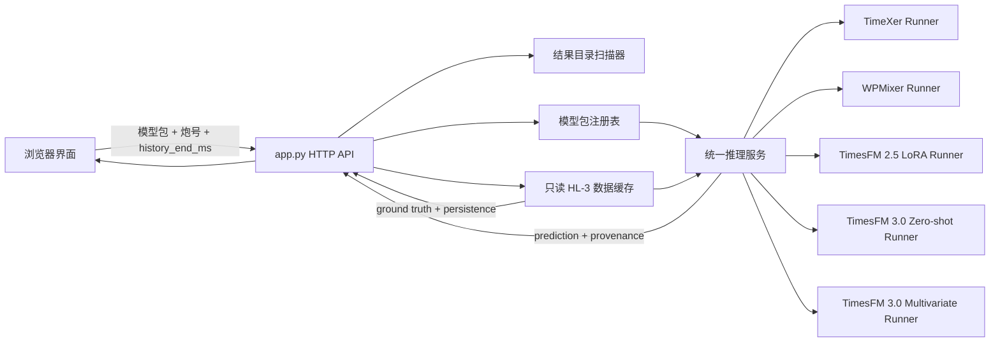

# PredictSawtooth Viewer 架构

## 1. 目标与边界

PredictSawtooth Viewer 是一个本地、只读的模型结果查看与推理系统。它负责发现已经训练
完成的模型包、在真实波形上选择历史窗口、执行推理并展示对照结果。

系统不负责在线训练、修改 checkpoint、编辑原始数据或自动发布实验结论。

## 2. 总体架构



## 3. 目录职责

| 路径 | 职责 |
|---|---|
| `frontend/` | 三步选择流程、IP/SXR 双轨导航、结果图与主题 |
| `src/result_catalog.py` | 只读扫描已保存结果，排除 smoke、未完成和非 160 ms 项 |
| `src/model_registry.py` | 校验 manifest、工件路径、完成状态和模型指纹 |
| `src/inference.py` | 统一 Runner、数据恢复、模型缓存、预测与 provenance |
| `src/metrics.py` | MAE、NRMSE、相关系数、R² 等连续波形指标 |
| `app.py` | 静态页面与 `/api/*` 接口 |
| `model_registry/` | 每个模型的声明、预处理配置和本地权重位置 |
| `tests/` | 模型包安全、页面契约、导航和真实推理回归 |

## 4. 请求流程

### 4.1 选择阶段

1. 后端扫描保存结果和 `model_registry/`。
2. 模型包通过完整性校验后标记为 `ready`。
3. 前端按模型族展示配置，并根据配置更新可选炮号。

固定选择状态为：

```text
model_package_id + model_variant + shot
```

### 4.2 时间窗阶段

1. 浏览器请求指定炮号的 IP、目标 SXR 和有效 NBI 区间。
2. 绘图数据允许下采样，但窗口索引仍映射到原始缓存采样率。
3. 用户只提交 `history_end_ms`，不能从浏览器提交自定义模型输入数组。

### 4.3 推理阶段

1. 后端重新读取对应炮号的只读缓存。
2. 根据 manifest 恢复物理通道顺序、availability 标记、采样率和窗口。
3. Runner 按模型契约执行推理，真实未来不会进入模型输入。
4. 后端在推理后读取 ground truth，并构造同时间轴的 Persistence。
5. 返回预测、指标、设备、耗时、模型指纹和时间范围。

## 5. 模型包契约

每个一级目录是独立模型包：

```text
model_registry/<model_package_id>/
├── manifest.json
├── run_config.json
├── scaler.json
├── completed.json
└── <checkpoint or base_model>/
```

`manifest.json` 是唯一可信的接入声明，至少定义：

- Runner、模型族和模型变体；
- checkpoint 与配置的包内相对路径；
- 输入通道、目标通道和固定顺序；
- 源采样率、模型采样率、history/gap/prediction；
- 支持炮号、数据处理版本和目录展示元数据。

工件路径解析后必须仍位于模型包目录内。manifest 不能指定任意 Python 脚本或 shell
命令。

## 6. TimesFM 3.0 两种模式

### Zero-shot

读取目标通道 `SX2_7_07`，从 10 kHz 降采样至 1 kHz，以 160 点历史预测未来 20 点。

### Native multivariate

按 manifest 固定顺序读取 13 个物理通道，形成 `(13, 160)` 上下文。TimesFM 3.0 原生
多变量预测返回 `(13, 20)`，页面只提取 `SX2_7_07` 对应输出。二值 availability 标记
不会被伪装成连续物理变量。

两个 TimesFM 3.0 模型包独立保存工件；运行时服务最多长期缓存一个 TimesFM 3.0 实例，
避免重复占用大量内存。

## 7. 数据与安全边界

- 原始波形、缓存、标签、保存结果和权重不进入公开 Git 仓库。
- 炮号可作为模型支持范围和测试选择公开。
- 模型扫描和推理均只读，结果不会写回模型目录。
- 页面选窗是回顾性定位，不代表真实在线因果验证。
- 真实未来仅用于推理完成后的评价。
- 缺失数据、缺失权重或不支持 Runner 时明确降级，不使用示例数组冒充结果。

## 8. 扩展新模型

同结构 checkpoint 只需建立完整模型包。新结构需要：

1. 在 `src/inference.py` 实现受控 Runner；
2. 在 `src/model_registry.py` 注册 Runner 名称；
3. 添加 manifest 和工件校验；
4. 增加固定窗口数值回归测试；
5. 更新模型包规范和本文档。

模型接入完成后，选择页应自动发现，不应在前端复制模型族专用推理逻辑。
